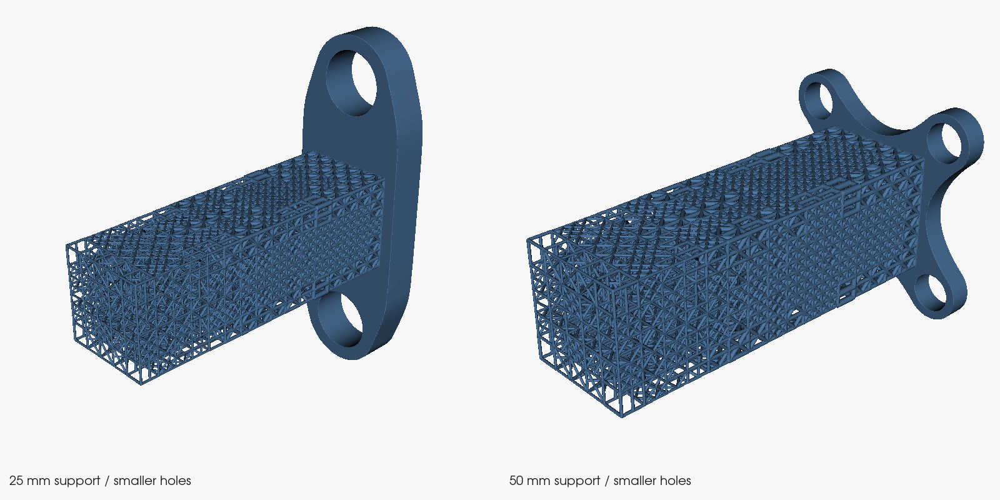

# cantilever-new

`modal3/uniform3`, `modal4/uniform4`, `modal8/uniform8` 형상을 pygalmesh volume mesh → ANSYS SOLID187 TET10으로 변환하고, 네 재료의 무구속 free-free modal 해석을 실행합니다.

## 입력 형상

3/4번 모델은 Git에 포함된 3MF beam-lattice/ball graph를 직접 사용합니다. nTop 및 중간 OBJ/surface mesh는 해석에 필요하지 않습니다.

- `geometry/modal_cantilever3_corrected.3mf`
- `geometry/uniform_cantilever3_volume_matched.3mf`
- `geometry/*_s0.5_thick_lattice_graph.3mf`

8번 모델만 용량 때문에 `v1.0` Release의 `modal-8.stl.zip`, `uniform-8.stl.zip`을 자동 다운로드합니다. 공개 저장소이므로 GitHub 인증은 필요하지 않습니다.

## 8번 STL 모델

8번 모델은 OBJ 변환 없이 Binary STL을 블록 단위로 읽습니다. `models8.json`에 원본/ZIP SHA-256과 형상 정보를 기록했습니다. 로컬 STL은 저장소 루트에 두며 Git에는 포함하지 않습니다.

| 모델 | 삼각형 수 | STL 부피 (mm³) |
|---|---:|---:|
| `modal-8.stl` | 49,735,004 | 85,595.7088 |
| `uniform-8.stl` | 48,574,016 | 85,419.9356 |

두 모델은 지그를 제외한 1:1 mm 형상이며, 입력 부피 차이는 modal 기준 약 0.205%입니다. 프린팅용 지그 포함 부피와 구별해야 합니다. 두 모델 모두 voxel 간격은 0.2 mm, 기존 3/4 모델 설정은 유지합니다. 실제 STL→voxel 검증에서 부피 변화는 modal −0.160%, uniform −0.200%이며 odd ray는 모두 0개였습니다. 이는 tetra 생성/ANSYS 실행 또는 주파수 수렴 검증 결과는 아닙니다.

8번 두 모델만 실행:

```powershell
python .\run.py --cases modal-8 uniform-8
```

실제 해석 없이 8번 whitened 입력 파일만 생성:

```powershell
python .\run_all_modal.py --cases modal-8 uniform-8 --prepare-only
```

인자 없이 실행하면 새 symmetric modal/uniform 6개를 해석합니다. 기존 3/4/8번은 `--cases`로 지정할 수 있습니다. 최종 tetra 부피가 기준 부피와 3% 이상 다르면 실패합니다. 주파수 비교에는 요소 크기 수렴을 별도로 확인해야 합니다.

## 실행

Windows에서는 CGAL 의존성까지 설치되는 conda-forge 환경을 사용합니다.

```powershell
conda env create -f environment.yml
conda activate cantilever
python .\run.py
```

ANSYS를 자동으로 찾지 못하면:

```bash
python run.py --exe "C:\\Program Files\\ANSYS Inc\\v252\\ansys\\bin\\winx64\\ANSYS252.exe"
```

`run.py`가 다음 작업을 순서대로 수행합니다.

1. 3MF graph 또는 Binary STL을 voxel union → pygalmesh/CGAL TET4로 변환
2. edge 중간 절점을 추가해 SOLID187 TET10 CDB 생성
3. 각 형상에서 whitened `ν=0.30`, `ν=0.39` 두 번만 해석
4. `sqrt(E/ρ)` scaling으로 네 재료의 주파수 생성
5. `runs/free_free_modal_frequencies_all.csv` 저장

| 재료 | E (MPa) | ν | ρ (tonne/mm³) |
|---|---:|---:|---:|
| Inconel 718 | 165,000 | 0.30 | 8.220e-9 |
| Structural Steel | 200,000 | 0.30 | 7.850e-9 |
| EOS MaragingSteel MS1 (열처리) | 190,000 | 0.30 | 8.100e-9 |
| Formlabs Nylon 12 | 1,850 | 0.39 | 9.900e-10 |

ANSYS 기준 물성은 `E=1 MPa`, `ρ=1 tonne/mm³`이며 포아송비별로 해석합니다. 같은 포아송비의 실제 주파수는 `f = f_white × sqrt(E/ρ)`로 계산합니다. 경계조건은 없는 true free-free입니다. 추출된 12개 모드 중 1–6차는 강체 모드, 7–12차는 탄성 고유진동 `f1–f6`입니다.

## 3MF 직접 voxel 부피 검증

3MF의 butt-cap beam과 node ball을 직접 raster union합니다. 중간 surface가 없어 watertight/self-intersection 문제에 의존하지 않습니다.

| 쌍 | Modal voxel (mm³) | Uniform voxel (mm³) | 차이 |
|---|---:|---:|---:|
| 3 | 86,399.552 | 86,428.912 | 0.034% |
| 4 | 10,805.797 | 10,813.515 | 0.071% |

최소 스트럿 지름은 modal에서 4 voxel, uniform에서 8 voxel 이상입니다. Modal은 voxel 간격을 한 번 더 절반으로 줄였을 때 부피 변화가 3번 `0.071%`, 4번 `0.138%`였습니다. 주기적인 uniform 격자는 5개 sub-voxel offset으로 aliasing을 확인한 뒤 반지름을 각각 `1.015`, `1.005`배 보정했습니다. 해석 시 유효 uniform 반지름은 3번 `0.818196 mm`, 4번 `0.413683 mm`입니다. 이는 부피 수렴 검증이며 주파수 mesh 수렴 검증은 아닙니다.

### 연속 implicit field → marching-cubes 계열 표면

STL 추출은 같은 격자 간격에서 0/1 occupancy 대신 beam/ball의 연속 거리 field를 사용합니다. `min`으로 union한 뒤 VTK FlyingEdges3D로 0 등위면을 보간합니다. 원통은 flat cap을 유지하며 smoothing이나 반지름 재보정은 하지 않습니다. 새 6개 모델의 volume mesh는 같은 field를 trilinear 보간한 `pygalmesh.DomainBase`로 직접 CGAL에 전달합니다. 따라서 해석용으로 수백 MB STL을 다시 읽거나 field를 0/1로 되돌리지 않습니다. 기존 3/4/8 모델의 volume 경로는 유지합니다.

```powershell
conda env update -f environment.yml
python .\export_voxel_surface.py modal_cantilever4
python .\test_implicit_surface.py
```

출력: `geometry/modal_cantilever4_implicit_surface.stl`. `0.125 mm` 격자에서 7,966,408 triangles, 부피 `10,823.804 mm³` (기준 voxel 대비 `+0.167%`)입니다. 폐쇄 edge-manifold, 연결 표면 1개, PyMeshLab self-intersection 0 faces를 확인했습니다. 검증에 실패하면 STL을 저장하지 않습니다. 기존 `*_direct_voxel_surface.stl`은 비교용으로 유지합니다.

CSV에서 4번 3MF를 다시 만들려면:

```powershell
python .\csv_to_thick_graph_3mf.py
```

## 새 symmetric modal 3개와 부피 일치 uniform

원본 `cantilever24_uniform5449_from_modal_s0.5.3mf`를 16/24셀로 맞추고 필요한 경우 좌표를 2배 확대했습니다. Modal 원본은 변경하지 않았습니다. 아래는 같은 격자의 연속 implicit 표면 부피 기준이며, 해석 시 별도의 기존 `RADIUS_SCALES`를 추가 적용하면 안 됩니다.

| Modal 구분 | 셀 배열 / 셀 크기 | Uniform 반지름 (mm) | Modal / Uniform 부피 (mm³) | 차이 |
|---|---|---:|---:|---:|
| 16 sym iface5 | 16×5×5 / 10 mm | 0.832564067 | 87,937.789 / 87,933.366 | 0.00503% |
| 16 sym island iface5 s0.5 | 16×5×5 / 5 mm | 0.411729972 | 10,764.765 / 10,764.478 | 0.00266% |
| 24 sym island iface5 s0.5 | 24×5×5 / 5 mm | 0.412720904 | 16,138.867 / 16,140.261 | 0.00864% |

출력: `geometry/cantilever{16,24}_uniform5449_volume_matched_sym*.3mf`. 파일별 매칭, 격자 간격, 부피 및 SHA-256은 `geometry/new_uniform_volume_matches.json`에 기록했습니다. 각 최종 modal/uniform 표면에서 폐쇄 edge-manifold, 연결 표면 1개, self-intersection 0 faces를 확인했습니다.

두 브랜치의 기본 해석 대상은 다음 6개입니다.

- `modal16_full`, `uniform16_full`: 16×5×5셀, 셀 크기 10 mm
- `modal16_half`, `uniform16_half`: 16×5×5셀, 셀 크기 5 mm
- `modal24_half`, `uniform24_half`: 24×5×5셀, 셀 크기 5 mm

각 브랜치에서 `python .\run.py`를 실행하면 형상 6개 × 포아송비 2개 = 12회 해석으로 네 재료의 24개 결과 행을 생성합니다. `main`은 free-free, `fixed-x-le-0`는 x≤0 고정입니다. 예를 들어 24셀 쌍만 실행하려면 `python .\run.py --cases modal24_half uniform24_half`를 사용합니다.

STL 6개는 `geometry/{modal,uniform}{16_full,16_half,24_half}_implicit_surface.stl`이며, `v1.0` Release의 `symmetric_modal_uniform_6_stl.zip`에서도 받을 수 있습니다. 파일별 크기·삼각형 수·부피는 `geometry/new_matched_stl_manifest.json`에 기록했습니다. STL 자체는 단위 정보가 없으므로 mm로 가져옵니다.

```powershell
python .\export_voxel_surface.py --all-new
python .\run_all_modal.py --prepare-only
python .\test_new_modal_cases.py
# CGAL이 설치된 환경에서 실제 작은 구 tetra 생성까지 확인:
python .\test_new_modal_cases.py --cgal
```

로컬에서 STL 6개 생성/검증과 입력 deck 테스트를 완료했습니다. 새 field 경로의 실제 CGAL volume 생성과 ANSYS 해석 완료를 의미하지는 않습니다.

```powershell
python .\match_uniform_3mf.py
python .\test_match_uniform_3mf.py
```

## STEP 고정부를 결합한 출력용 STL 6개

`geometry/Support.step`은 구멍을 작고 간단하게 변경한 최신 파일이며, SHA-256은 `c74dca52ed265a3f9d824bc9948dd116c1b2bdcc2606a95d67778d39b9cdeb69`입니다. 두 개의 solid가 있습니다. 50 mm 베이스는 `16_full` 두 모델에, 25 mm 베이스는 `16_half/24_half` 네 모델에 사용했습니다. STEP의 배치를 그대로 유지합니다: 고정부 `x=-10..0`, 격자 시작면 `x=0`. 접합부의 실제 solid overlap을 확인했으며 별도 이동·반지름 변경은 하지 않았습니다.

STEP 고정부만 0.02 mm 공차로 tessellate한 뒤 signed-distance field로 변환하고, 격자 field와 union하여 하나의 STL을 생성합니다. 격자를 CAD로 변환하거나 tetra mesh를 생성하지 않습니다. 기존과 같은 격자 간격(큰 모델 0.2 mm, 작은 모델 0.125 mm)을 사용합니다.

출력: `geometry/{modal,uniform}{16_full,16_half,24_half}_with_support.stl`. 최신 파일은 `v1.0` Release의 `symmetric_modal_uniform_6_with_support_small_holes_stl.zip`에 STL 6개와 검증 보고서·미리보기를 포함했습니다. 이전 구멍 형상의 `symmetric_modal_uniform_6_with_support_stl.zip`은 비교용으로 유지합니다.

검증: STEP solid 유효성, 고정부 tessellation 부피 오차 0.2% 이내, 고정부 implicit 부피 오차 1% 이내, 접합부 양의 겹침, 최종 연결 표면 1개, boundary/non-manifold edge 0개, self-intersecting face 0개. 저장된 binary STL의 양의 signed volume과 원래 surface 부피 일치 및 SHA-256도 확인했습니다. 상세 값은 `geometry/supported_print_models.json`에 있습니다.

접합부에서 제거되는 중복 부피가 모델마다 달라 **고정부를 포함한 총 부피는 기존 격자 부피 매칭과 별개**입니다. 출력용 파일만 추가했으며 해석용 3MF, 기본 해석 대상 및 고정 조건은 변경하지 않았습니다.

```powershell
conda env update -f environment.yml
python .\export_supported_stl.py
python .\test_supported_stl.py
```



## 3D 프린팅용 경량 OBJ

Release의 `*_print.obj.zip`은 원본 대비 face 수를 약 90% 줄이고 MeshFix로 폐쇄·manifold 상태를 복구한 파일입니다.

| 형상 | 원본 face | 경량 face | 부피 변화 |
|---|---:|---:|---:|
| modal | 49,907,540 | 4,987,952 | -0.177% |
| uniform | 48,789,056 | 4,875,214 | -0.184% |

두 경량 모델 사이의 부피 차이는 약 `0.019%`입니다. 다시 만들려면 `python .\reduce_obj_for_print.py`를 실행합니다.
